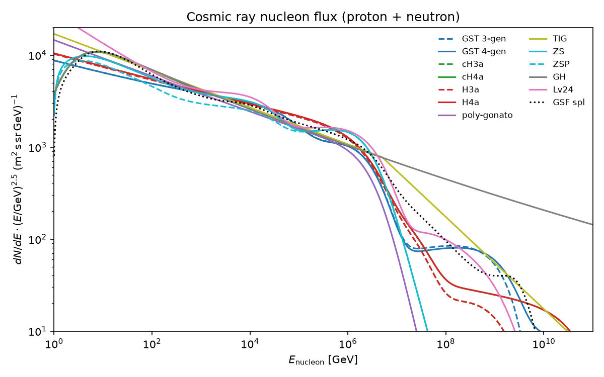
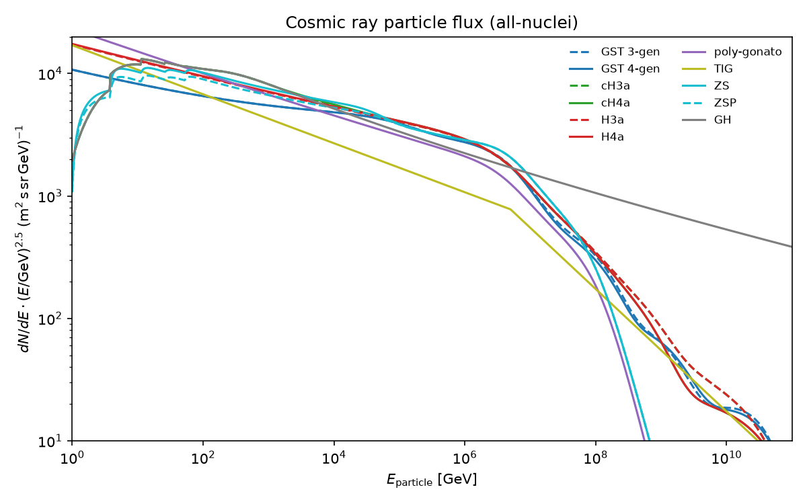
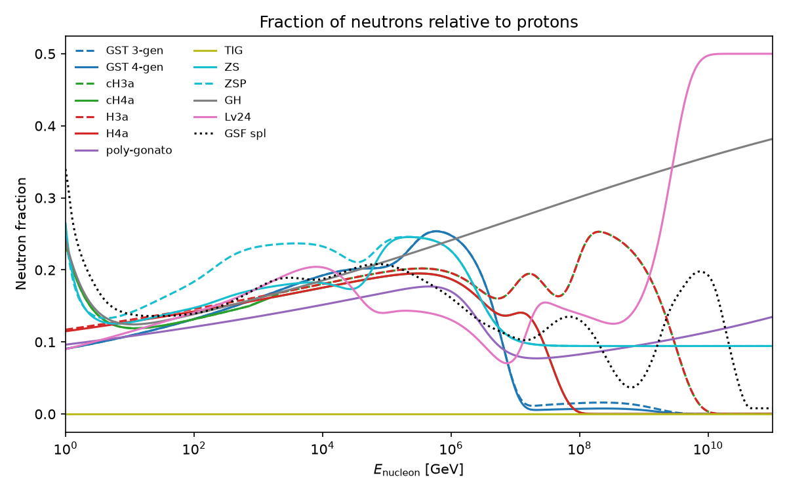
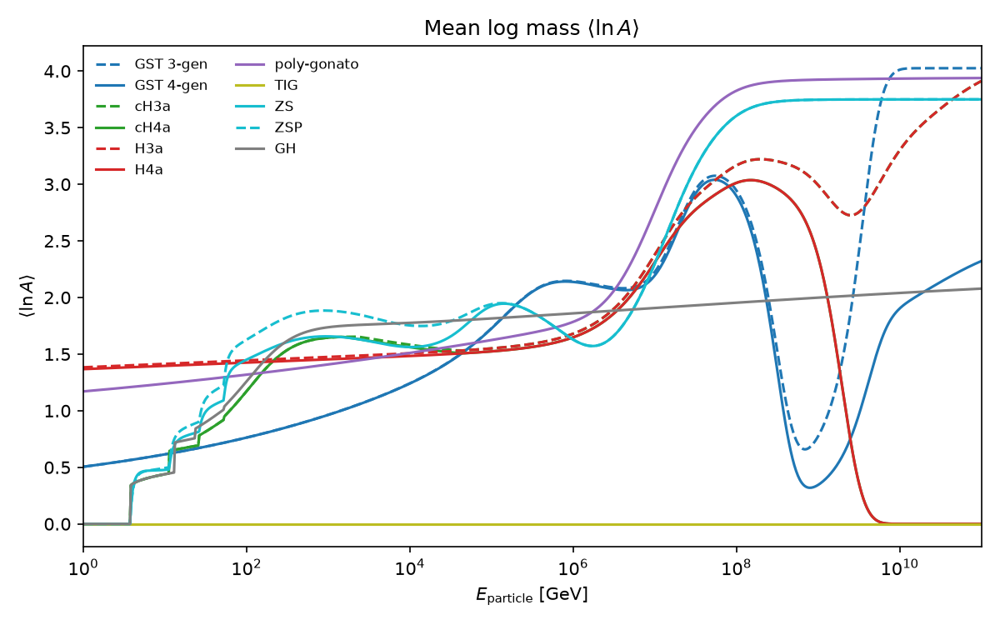
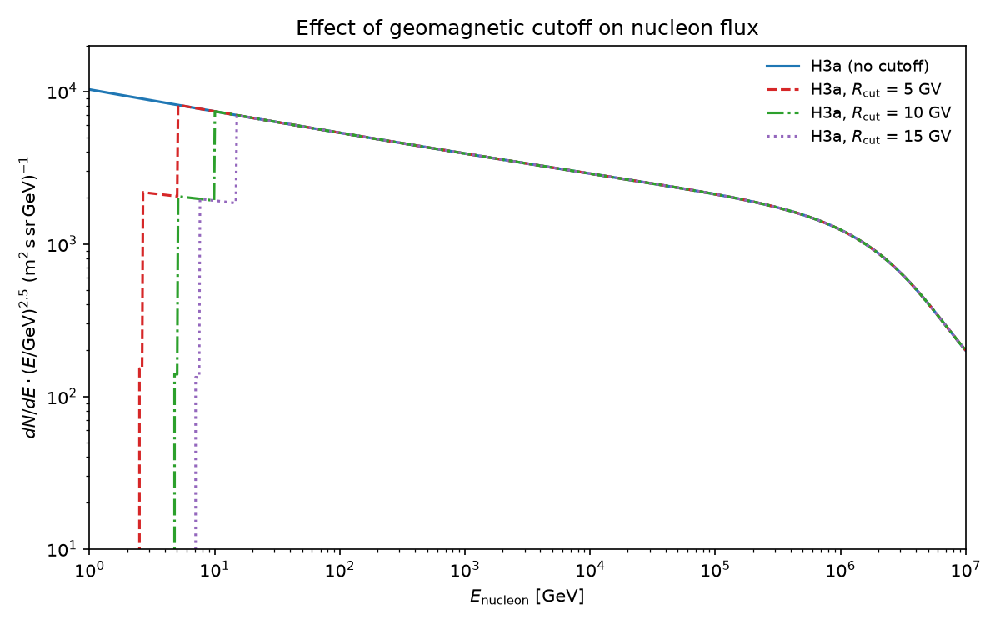

# Available Models

All models inherit from `PrimaryFlux` and implement the same interface.
They accept an optional `geomagnetic_cutoff` parameter (in GV) that zeros
the flux below the corresponding rigidity for each nucleus.

## Model Comparison

### Nucleon Flux

All-nucleon flux (proton + neutron) scaled by $E^{2.5}$ for visibility across the full energy range.



### All-Particle Flux

Total flux of all nuclei (all-particle spectrum) scaled by $E^{2.5}$.



### Neutron Fraction

Fraction of neutrons in the nucleon flux, showing composition differences between models.



### Mean Logarithmic Mass

$\langle\ln A\rangle$ as a function of energy per particle. Higher values indicate heavier composition.



## Parameterized Models

| Class | Reference | Energy Range | Notes |
|-------|-----------|-------------|-------|
| `HillasGaisser2012` | Gaisser, Astropart. Phys. 35, 801 (2012) | Full range | Variants: `H3a`, `H4a` |
| `H3a_polygonato` | Modified Gaisser (2012) | Full range | Poly-gonato at low E |
| `GaisserStanevTilav` | Gaisser, Stanev, Tilav, arXiv:1303.3565 (2013) | Full range | Variants: `3-gen`, `4-gen` |
| `CombinedGHandHG` | Fedynitch et al., PRD 86, 114024 (2012) | Full range | GH at low E, HG at high E |
| `PolyGonato` | Hoerandel, Astropart. Phys. 19, 193 (2003) | Full range | 11 mass groups |
| `ZatsepinSokolskaya` | Zatsepin & Sokolskaya, A&A 458, 1 (2006) | < 1-10 PeV | Variants: `default`, `pamela`; fit in kinetic energy per nucleus, force-field modulation Φ = 600 MV |
| `GaisserHonda` | Gaisser & Honda, ARNPS 52, 153 (2002) | < 100 TeV | Tuned to balloon data; fit in kinetic energy per nucleon; Table 2 central values, CNO as 1407 (A = 14), Mg-Si as 2512 (A = 25) |
| `Thunman` | Thunman et al., Astropart. Phys. 5, 309 (1996) | Full range | Proton-only broken power law |
| `SimplePowerlaw27` | Based on Thunman | Below knee | Proton-only $E^{-2.7}$ |
| `GlobalSplineFit` | Fedynitch et al., arXiv:2609.32649 (2026) | 1 GeV - $10^{11}$ GeV | Via globalsplinefit (`gsf` extra); all species, versions 2026.1/2025/2019/2017 |
| `GlobalSplineFitReduced` | Fedynitch et al., arXiv:2609.32649 (2026) | 1 GeV - $10^{11}$ GeV | Nucleon flux only, pivot uncertainty parameters |
| `GlobalSplineFitBeta` | Dembinski et al., PoS ICRC2017 533 | 10 GV - $10^{11}$ GeV | Deprecated: GSF 2017 nucleon flux at φ = 554 MV |

## Nucleus ID Scheme (CORSIKA)

Protons have ID 14. Composite nuclei: `ID = 100 * A + Z`

| Nucleus | A | Z | CORSIKA ID |
|---------|---|---|-----------|
| Proton | 1 | 1 | 14 |
| Helium | 4 | 2 | 402 |
| Carbon | 12 | 6 | 1206 |
| Silicon | 28 | 14 | 2814 |
| Iron | 56 | 26 | 5626 |

All `nucleus_flux` energies are total energies of the nucleus. Models fitted
in kinetic energy (`GaisserHonda`, `ZatsepinSokolskaya`) are converted with the
Jacobian of that change of variable.

## Geomagnetic Cutoff

All models accept `geomagnetic_cutoff` (in GV) as a constructor parameter.
It is a cut in rigidity: the flux of a nucleus with charge $Z$ and mass number
$A$ is zeroed where its momentum $p = \sqrt{E^2 - M^2}$ is below $Z R_\text{cut}$,
with $E$ the total energy of the nucleus and $M = A \times 0.93892$ GeV (mean
nucleon mass, as in globalsplinefit). The energy threshold is
$E_\text{cut} = \sqrt{(Z R_\text{cut})^2 + M^2}$, which tends to $Z R_\text{cut}$
for $E \gg M$. `None` or 0 means no cutoff.

```python
import crflux.models as mods

# 7 GV cutoff (typical for mid-latitudes)
model = mods.HillasGaisser2012("H3a", geomagnetic_cutoff=7.0)
```

The plot below shows the effect of different cutoff values on the H3a nucleon flux:



## Global Spline Fit (GSF)

`GlobalSplineFit` wraps [globalsplinefit](https://github.com/gsf-project/globalsplinefit)
as a `PrimaryFlux`: per-nucleus fluxes for every species of the chosen version
(CORSIKA ids, 201 = deuterium where carried) and exact proton/neutron nucleon
fluxes. `GlobalSplineFitReduced` is its nucleon-only special case with the
uncertainty as relative-flux parameters at pivot energies (`ReducedGSF`).
Install with `pip install "crflux[gsf]"` (Python >= 3.10). Reference:
A. Fedynitch, K. Fujisue, H. Dembinski, R. Engel,
[arXiv:2609.32649](https://arxiv.org/abs/2609.32649) (2026).

```python
from crflux.models import GlobalSplineFit, GlobalSplineFitReduced
import numpy as np

gsf = GlobalSplineFit(version="2026.1")  # also "2025", "2019", "2017"
gsf.nucleus_flux(5626, 1e6)  # iron, total energy per nucleus
gsf.gsf.error(np.logspace(3, 6, 4), "Fe*")  # underlying globalsplinefit model

central = GlobalSplineFitReduced(version="2026.1")
red = central.reduction
theta = np.zeros(red.n_params)
theta[3] = red.sigma[3]  # +1 sigma on pivot 3
varied = GlobalSplineFitReduced(reduction=red, theta=theta)
fraction, proton, neutron = varied.p_and_n_flux(np.logspace(0, 8, 50))
```

Energies are total GeV (per nucleus for `nucleus_flux`, per nucleon for
`p_and_n_flux`). `time_interval` selects the solar-modulation period (default
Solar Cycle 24, `"LIS"` for none). `geomagnetic_cutoff` is applied by
globalsplinefit per species in rigidity, with a sigmoid transition of width
`cutoff_width` (default 1 GV; 0 = sharp step); a cutoff of 0 is no cutoff.
Kinetic-energy reductions are rejected.
`GlobalSplineFitBeta` is deprecated: its table is GSF 2017 at a fixed
φ = 554 MV, i.e. `GlobalSplineFit(version="2017", time_interval=(199807, 199808))`.
Having no composition, it refuses a `geomagnetic_cutoff` (`ValueError`), and
its `nucleus_flux`, `total_flux` and `lnA` raise `NotImplementedError`, as do
those of `GlobalSplineFitReduced`. The reduced model does take a cutoff: it is
applied per species by globalsplinefit before the reduction.
